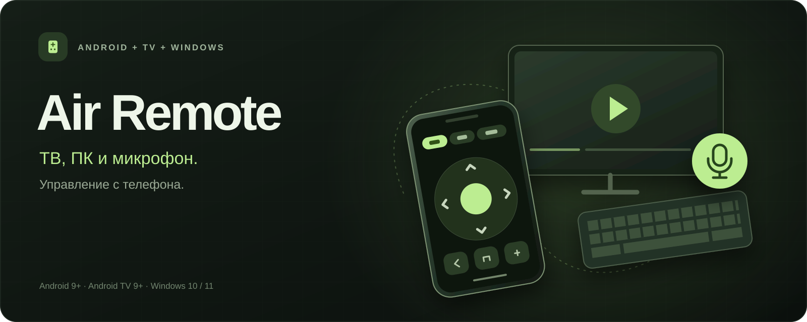
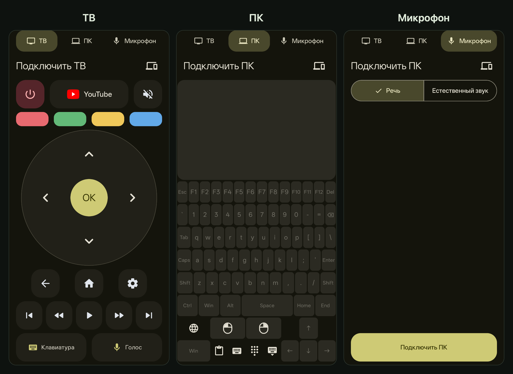

**Air Remote** — пульт для телевизора и ПК: кнопки, клавиатура, трекпад и передача микрофона с телефона. На Android 12+ цвета интерфейса подстраиваются под тему телефона. Аккаунт и облачный сервер не нужны.

  
  
  
  

  Obtainium:
  <a href="https://apps.obtainium.imranr.dev/redirect?r=obtainium%3A%2F%2Fapp%2F%7B%22id%22%3A%22belowevolve.airremote%22%2C%22url%22%3A%22https%3A%2F%2Fgithub.com%2Fbelowevolve%2Fa-ir-remote%22%2C%22author%22%3A%22belowevolve%22%2C%22name%22%3A%22Air%20Remote%22%2C%22additionalSettings%22%3A%22%7B%5C%22apkFilterRegEx%5C%22%3A%5C%22%5EAir-Remote%5C%5C%5C%5C.apk%24%5C%22%7D%22%7D">Air Remote</a> ·
  <a href="https://apps.obtainium.imranr.dev/redirect?r=obtainium%3A%2F%2Fapp%2F%7B%22id%22%3A%22belowevolve.airremote%22%2C%22url%22%3A%22https%3A%2F%2Fgithub.com%2Fbelowevolve%2Fa-ir-remote%22%2C%22author%22%3A%22belowevolve%22%2C%22name%22%3A%22Air%20Remote%20Voice%22%2C%22additionalSettings%22%3A%22%7B%5C%22apkFilterRegEx%5C%22%3A%5C%22%5EAir-Remote-Voice%5C%5C%5C%5C.apk%24%5C%22%7D%22%7D">Voice</a>

Микрофон для ПК и голосовой поиск ТВ есть в обеих сборках пульта. **Voice** добавляет локальные команды «Эйр» при заблокированном телефоне. Сменить сборку можно установкой поверх: настройки и сопряжения сохранятся.

## Подключение

- **ТВ:** подключите устройства к одной домашней сети, выберите телевизор в пульте и введите код с его экрана. [Настройка](app/README.md#телевизор).
- **ПК:** клавиатура и трекпад работают по Bluetooth. Для вставки текста и клавиатуры Android установите [Air Companion](companion/README.md) и отсканируйте его QR-код.
- **Микрофон:** [передача звука с телефона на Windows](docs/microphone.md).
- **Эйр:** [включение голосового управления и команды](docs/voice.md).

[Air Home](tv/README.md#установка-на-телевизор) — необязательный лаунчер для Android TV / Google TV: приложения, HDMI, обои с цветовой темой и лента просмотра.

## Разработка

[Сборка Android](app/README.md#сборка) · [Air Home](tv/README.md#сборка) · [Windows](companion/README.md#сборка) · [Общие компоненты](shared/README.md).

## Авторы

Air Remote, Air Home и Air Companion — [belowevolve](https://github.com/belowevolve).

Сторонние проекты и лицензии

Сторонние приложения устанавливаются отдельно.

- **TizenTube Cobalt** — [reisxd и участники проекта](https://github.com/reisxd/TizenTubeCobalt); [релизы](https://github.com/reisxd/TizenTubeCobalt/releases/latest).
- **film.mov** — [gamahacka](https://github.com/gamahacka/filmmov); [официальный канал](https://t.me/filmmov_app), [поддержать автора](https://t.me/tribute/app?startapp=dSVL).
- **CleanYourTV** — [Gathin23 и участники](https://github.com/Gathin23/cleanyourtv), необязательные инструменты очистки ТВ.
- **Vosk** — [Alpha Cephei](https://alphacephei.com/vosk/), локальное распознавание в Voice, Apache-2.0.
- **VB-CABLE** — [VB-Audio](https://vb-audio.com/Cable/), donationware-компонент микрофона Windows.

Протокол ТВ: [androidtvremote2](https://github.com/tronikos/androidtvremote2), [Google TV pairing](https://android.googlesource.com/platform/external/google-tv-pairing-protocol/), [Apache-2.0](THIRD_PARTY_LICENSE_androidtvremote2). Авторство обоев и компонентов Air Home — в [CREDITS](tv/src/main/assets/CREDITS.md).

