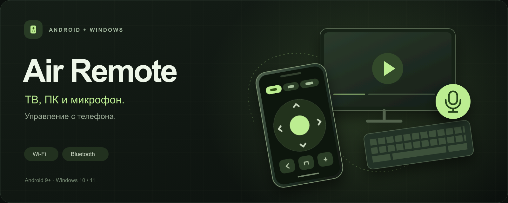
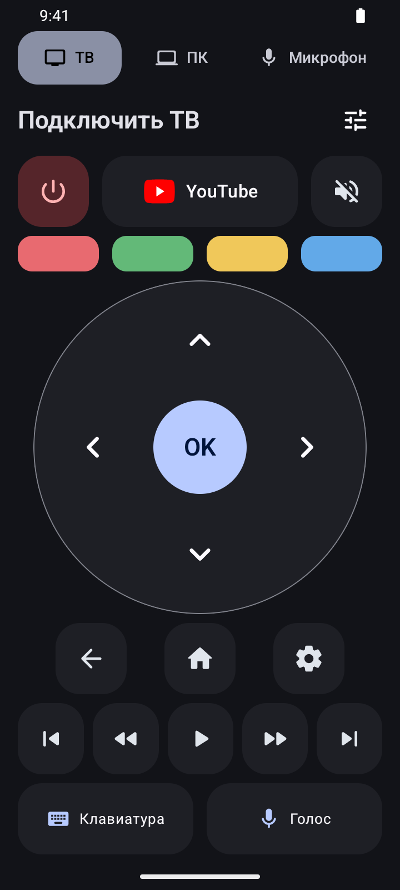
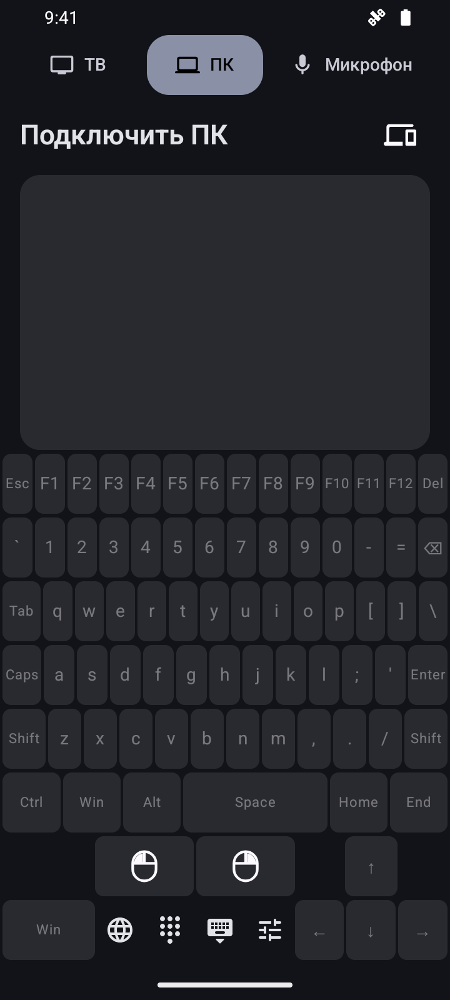
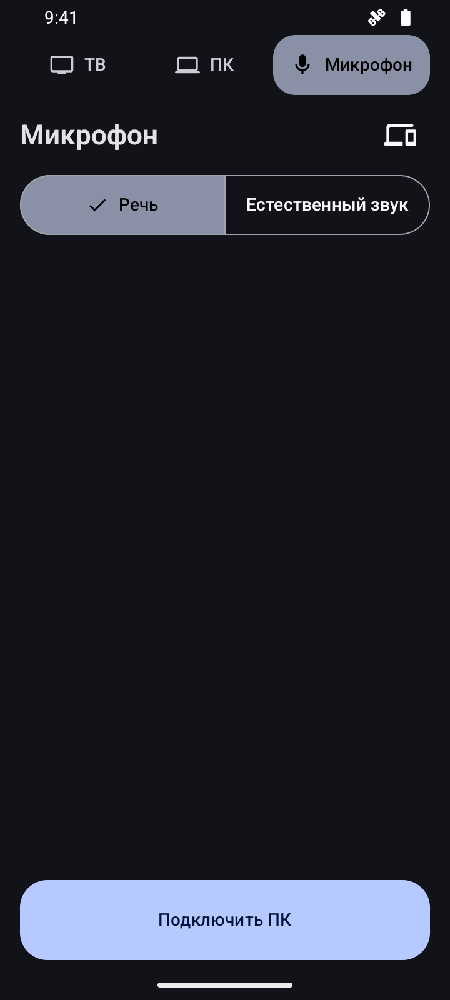

  
  
  

Android 9+ · Windows 10/11 x64

| ТВ | ПК | Микрофон |
| :---: | :---: | :---: |
|  |  |  |
| Кнопки, голосовой поиск и ввод текста. | Клавиатура, мышь и трекпад по Bluetooth. | Звук с телефона в Discord, OBS и игры. |

## Подключение

- **ТВ:** одна Wi-Fi-сеть → выберите телевизор → введите код с экрана.
- **ПК:** включите видимость в приложении и выполните Bluetooth-сопряжение. Один палец — курсор, два — прокрутка, удержание — перетаскивание.
- **Микрофон:** Windows Setup → QR в окне компаньона → CABLE Output в приложении на ПК. [Инструкция](docs/microphone.md).

Windows-компаньон также синхронизирует раскладку RU / EN. Для клавиатуры и трекпада достаточно Bluetooth.

Протокол ТВ: <a href="https://github.com/tronikos/androidtvremote2">androidtvremote2</a> и <a href="https://android.googlesource.com/platform/external/google-tv-pairing-protocol/">Google TV pairing</a> · <a href="THIRD_PARTY_LICENSE_androidtvremote2">Apache-2.0</a>.
